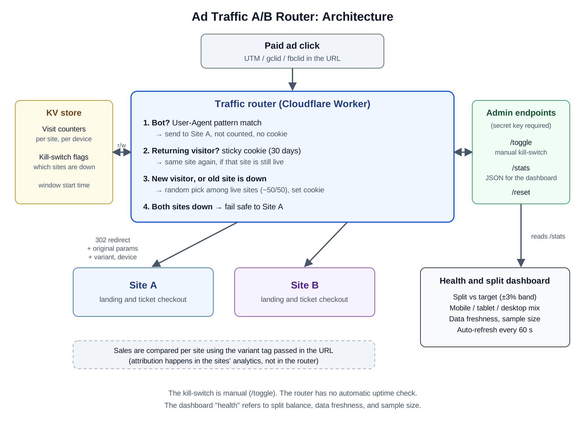

# Ad Traffic A/B Router

A lightweight traffic splitter I built to compare two websites on real paid-ad traffic. It sends each ad click to Site A or Site B, keeps returning visitors on the same site, filters out obvious bots, and feeds a dashboard that shows whether the split is healthy.

Built on **Cloudflare Workers + KV** (JavaScript). The dashboard is a single HTML file. All data shown in the screenshots is demo data.

## The problem

Paid ads were driving traffic to a ticket-sales website, and the question was whether a redesigned site (Site B) would sell more than the current one (Site A). A fair test needs:

- A roughly even split of ad traffic between the two sites.
- The same visitor always seeing the same site, so results aren't mixed up.
- Bots and previews kept out of the numbers.
- Ad tracking parameters (UTM, gclid, fbclid) preserved so ad reporting still works.
- A way to pause one site quickly without redeploying code.
- A simple view for non-technical stakeholders to check the test is running properly.

## How it works

1. **Entry point.** Ad links point to the router instead of a site.
2. **Bot check.** If the User-Agent matches a bot/crawler/preview pattern, the visitor is sent to Site A, is not counted, and gets no cookie.
3. **Sticky assignment.** A returning visitor with a valid cookie (30 days) goes back to the same site, as long as that site is live.
4. **New assignment.** A new visitor, or one whose previous site is marked down, is randomly assigned among live sites (~50/50) and given a cookie.
5. **Fail-safe.** If both sites are marked down, everyone goes to Site A.
6. **Redirect.** A `302` sends the visitor to the chosen site, carrying all original query parameters plus `variant` (A or B) and `device` (mobile, tablet, desktop), so each site's analytics can tag the session.
7. **Counting.** Each real visit increments per-site, per-device counters in KV.

## Endpoints (secret key required)

| Endpoint | Purpose |
|---|---|
| `/toggle?site=A\|B` | Manual kill-switch: mark a site down or up without touching code |
| `/stats` | JSON counters used by the dashboard |
| `/reset` | Wipe counters before launch |

## Dashboard

A single HTML file that reads `/stats` and refreshes every 60 seconds. It shows:

- Traffic split per site against the target, with a ±3% acceptable band
- Mobile, tablet, and desktop mix per site (an A/B winner overall can still lose on phones)
- Health checks: data freshness, balanced split, sufficient sample size
- A plain-English guide for non-technical readers

## Design decisions

- **Cookie-based stickiness** instead of hashing, so a visitor stays on one site even if the live-site set changes.
- **Edge redirect** instead of a proxy, which keeps latency low and keeps ad parameters intact.
- **KV for state** because the counters and kill-switch flags are small and need to be shared across edge locations.
- **Manual kill-switch** so an operator can pull a site immediately with one request.
- **Fail-safe to Site A** so a misconfiguration never produces a dead link on a paid ad.

## Known limitations and what I'd improve

- **Kill-switch is manual.** There is no automatic uptime check. Next step: a scheduled health check (Cron Trigger) that sets the down flags automatically and alerts on changes.
- **Counters are not atomic.** Each visit reads, increments, and rewrites one KV key, so concurrent visits can be undercounted. Next step: Durable Objects or Analytics Engine for exact counts.
- **Bot detection is User-Agent only.** It catches declared bots and previews, not sophisticated traffic. The "bots excluded" counter is not yet wired up in the router.
- **Admin key is passed in the URL.** Next step: move it to a request header.
- **No version control or CI.** The code was edited and deployed through the Cloudflare dashboard. Next step: put it in Git with Wrangler-based deploys.
- **No statistical check of the split.** Next step: a sample-ratio-mismatch test on the dashboard to flag a skewed split automatically.

## Stack

JavaScript, Cloudflare Workers, Cloudflare KV, HTML/CSS/JS dashboard.
